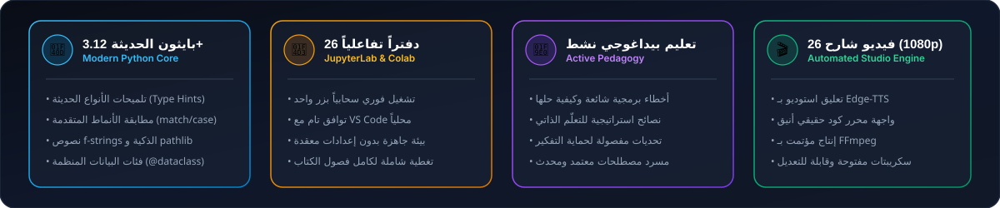
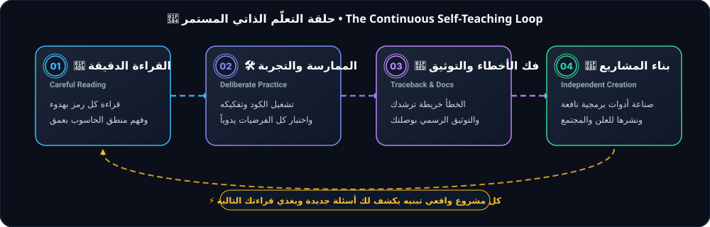
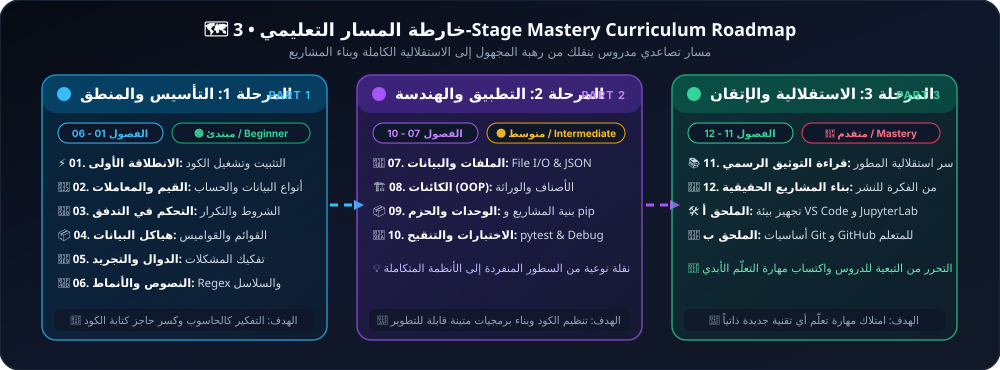

<div align="center">



<br/>

[](https://www.python.org/)
[](https://jupyter.org/)
[](./videos/README.md)
[](https://github.com/zeiad6/craft-of-selfteaching/actions)
[](LICENSE)
[](CONTRIBUTING.md)

<br/>

**[🇸🇦 تصفح النسخة العربية](./ar/README.md)** &nbsp;&nbsp;•&nbsp;&nbsp; **[🌐 Explore Full English Edition](./en/README.md)** &nbsp;&nbsp;•&nbsp;&nbsp; **[🎬 استوديو الفيديوهات الشارحة](./videos/README.md)** &nbsp;&nbsp;•&nbsp;&nbsp; **[💡 التحديات والحلول النموذجية](./ar/challenges/README.md)** &nbsp;&nbsp;•&nbsp;&nbsp; **[📖 مسرد المصطلحات](./ar/GLOSSARY.md)**

</div>

---

<div align="center">



</div>

---

<div dir="rtl">

## 🇸🇦 عن هذا المشروع: فلسفة التعلّم الذاتي

> **"التعلّم الذاتي ليس مجرّد بديل عن المدرسة؛ بل هو الحرفة الأم التي تحدّد سقف تطوّرك طوال حياتك."**

هذا المستودع هو تعريب تقني احترافي، وتطوير شامل للكتاب المفتوح الشهير **"The Craft of Self-Teaching" (自学是门手艺)** للمؤلف **لي شياولاي (Li Xiaolai)**. يتخذ هذا العمل من البرمجة بلغة **Python** ميداناً عملياً لتدريبك على امتلاك استقلالية التعلّم وكسر حاجز الخوف من المجهول.

<div align="center">



<br/>
<sub><i>حلقة التراكم المعرفي الأربعة: من القراءة المتأنية وحتى شحن المشاريع الواقعية للمجتمع</i></sub>

</div>

<br/>

### 🧠 القواعد الذهبية الأربع للمتعلّم الذاتي
1. **قراءة التوثيق أولاً (Read the Docs First):** معظم المشكلات التي تظنها معقدة تم حلها بالفعل وتوثيقها بدقة في المراجع الرسمية.
2. **رسالة الخطأ ليست إهانة؛ بل مرشد (Embrace the Traceback):** رسائل الخطأ في بايثون هي خريطة مجانية تدلك على سطر العطل وطبيعته. اقرأها بدم بارد.
3. **التعلّم بالتفكيك والتجربة (Deconstruction & Tinkering):** لا تكتفِ بقراءة الكود كأنه رواية؛ شغّله، غير المعاملات، اكسره عن قصد وافهم لماذا كُسر.
4. **المشاركة هي ذروة الفهم (Building & Sharing):** بناء المشاريع الحقيقية ومساعدة المتعلمين الآخرين هو الضمان الوحيد لرسوخ المهارة في عقلك إلى الأبد.

---

### ✨ ما يميز هذه النسخة المطوّرة؟
* **🇸🇦 تعريب تقني متوازن:** صياغة عربية أصيلة تجمع بين بلاغة العبارة ووضوح المصطلح التقني العالمي، مع [مسرد مصطلحات معتمد (GLOSSARY.md)](./ar/GLOSSARY.md).
* **🐍 ترقية معمارية لـ Python 3.12+:** استخدام أحدث مميزات اللغة مثل `match/case`، تلميحات الأنواع الحديثة `Type Hints`، فئات البيانات `@dataclass`، ومكتبة المسارات القياسية `pathlib`.
* **📓 تجربة تفاعلية متكاملة (26 دفتراً):** مطابقة تامة بين العربية والإنجليزية، قابلة للتشغيل الفوري بنقرة واحدة سحابياً عبر Google Colab.
* **💡 تصميم تعليمي نشط (Active Learning):**
  * ⚠️ **أخطاء شائعة (Common Mistakes):** تشريح واقعي للأخطاء البرمجية المتكررة.
  * 🧠 **نصائح التعلّم الذاتي (Self-Teaching Tips):** نماذج ذهنية للتحليل والتفكير المنطقي.
  * ❓ **اختبر نفسك (Check Your Understanding):** أسئلة تفاعلية مع إجابات مخفية منسدلة.
  * 🔑 **تحديات برمجية مفصولة الحلول:** تمارين متدرجة بدون حرق الحلول في الدفتر نفسه لتعزيز التفكير الذاتي.
* **🎬 استوديو إنتاج الفيديوهات (26 فيديو MP4 بدقة 1080p):** محرك مؤتمت بالكامل يدمج التعليق الصوتي الاستوديو (Edge-TTS) مع العروض المرئية البرمجية.

</div>

---

<div align="center">



</div>

---

## 🗺️ Master Curriculum Matrix | جدول الفصول والوصول السريع الموحّد

<div align="center">

| # | الفصل / Chapter | المستوى | المدة | 🇸🇦 الدفتر العربي | 🌐 English | ⚡ تشغيل سحابي | 🎬 فيديو 1080p | 🔑 الحل النموذجي |
| :-: | :-- | :-: | :-: | :-: | :-: | :-: | :-: | :-: |
| **00** | **Preface** (المقدمة والفلسفة) | 🟢 مبتدئ | ⏱️ 20m | [Notebook](./ar/00-preface/01-preface.ipynb) | [Notebook](./en/00-preface/01-preface.ipynb) | [](https://colab.research.google.com/github/zeiad6/craft-of-selfteaching/blob/main/ar/00-preface/01-preface.ipynb) | [▶️ MP4](./videos/rendered/ar_00-preface.mp4) | [📖 الملاحظة](./ar/00-preface/00-translator-note.md) |
| **01** | **Getting Started** (الانطلاقة الأولى) | 🟢 مبتدئ | ⏱️ 30m | [Notebook](./ar/part-1-foundations/01-getting-started.ipynb) | [Notebook](./en/part-1-foundations/01-getting-started.ipynb) | [](https://colab.research.google.com/github/zeiad6/craft-of-selfteaching/blob/main/ar/part-1-foundations/01-getting-started.ipynb) | [▶️ MP4](./videos/rendered/ar_01-getting-started.mp4) | [🔑 الحل](./ar/challenges/solutions/01-getting-started.md) |
| **02** | **Values & Operators** (القيم والمعاملات) | 🟢 مبتدئ | ⏱️ 35m | [Notebook](./ar/part-1-foundations/02-values-and-operators.ipynb) | [Notebook](./en/part-1-foundations/02-values-and-operators.ipynb) | [](https://colab.research.google.com/github/zeiad6/craft-of-selfteaching/blob/main/ar/part-1-foundations/02-values-and-operators.ipynb) | [▶️ MP4](./videos/rendered/ar_02-values-and-operators.mp4) | [🔑 الحل](./ar/challenges/solutions/02-values-and-operators.md) |
| **03** | **Control Flow** (التحكم في التدفق) | 🟢 مبتدئ | ⏱️ 40m | [Notebook](./ar/part-1-foundations/03-control-flow.ipynb) | [Notebook](./en/part-1-foundations/03-control-flow.ipynb) | [](https://colab.research.google.com/github/zeiad6/craft-of-selfteaching/blob/main/ar/part-1-foundations/03-control-flow.ipynb) | [▶️ MP4](./videos/rendered/ar_03-control-flow.mp4) | [🔑 الحل](./ar/challenges/solutions/03-control-flow.md) |
| **04** | **Data Structures** (هياكل البيانات) | 🟢 مبتدئ | ⏱️ 45m | [Notebook](./ar/part-1-foundations/04-data-structures.ipynb) | [Notebook](./en/part-1-foundations/04-data-structures.ipynb) | [](https://colab.research.google.com/github/zeiad6/craft-of-selfteaching/blob/main/ar/part-1-foundations/04-data-structures.ipynb) | [▶️ MP4](./videos/rendered/ar_04-data-structures.mp4) | [🔑 الحل](./ar/challenges/solutions/04-data-structures.md) |
| **05** | **Functions** (الدوال وتفكيك المشكلات) | 🟢 مبتدئ | ⏱️ 45m | [Notebook](./ar/part-1-foundations/05-functions.ipynb) | [Notebook](./en/part-1-foundations/05-functions.ipynb) | [](https://colab.research.google.com/github/zeiad6/craft-of-selfteaching/blob/main/ar/part-1-foundations/05-functions.ipynb) | [▶️ MP4](./videos/rendered/ar_05-functions.mp4) | [🔑 الحل](./ar/challenges/solutions/05-functions.md) |
| **06** | **Strings & Regex** (النصوص والأنماط) | 🟢 مبتدئ | ⏱️ 40m | [Notebook](./ar/part-1-foundations/06-strings-and-regex.ipynb) | [Notebook](./en/part-1-foundations/06-strings-and-regex.ipynb) | [](https://colab.research.google.com/github/zeiad6/craft-of-selfteaching/blob/main/ar/part-1-foundations/06-strings-and-regex.ipynb) | [▶️ MP4](./videos/rendered/ar_06-strings-and-regex.mp4) | [🔑 الحل](./ar/challenges/solutions/06-strings-and-regex.md) |
| **07** | **File I/O** (الملفات واستدامة البيانات) | 🟡 متوسط | ⏱️ 35m | [Notebook](./ar/part-2-practice/07-file-io.ipynb) | [Notebook](./en/part-2-practice/07-file-io.ipynb) | [](https://colab.research.google.com/github/zeiad6/craft-of-selfteaching/blob/main/ar/part-2-practice/07-file-io.ipynb) | [▶️ MP4](./videos/rendered/ar_07-file-io.mp4) | [🔑 الحل](./ar/challenges/solutions/07-file-io.md) |
| **08** | **OOP** (البرمجة كائنية التوجه) | 🟡 متوسط | ⏱️ 50m | [Notebook](./ar/part-2-practice/08-oop.ipynb) | [Notebook](./en/part-2-practice/08-oop.ipynb) | [](https://colab.research.google.com/github/zeiad6/craft-of-selfteaching/blob/main/ar/part-2-practice/08-oop.ipynb) | [▶️ MP4](./videos/rendered/ar_08-oop.mp4) | [🔑 الحل](./ar/challenges/solutions/08-oop.md) |
| **09** | **Modules** (الوحدات والمكتبات) | 🟡 متوسط | ⏱️ 35m | [Notebook](./ar/part-2-practice/09-modules.ipynb) | [Notebook](./en/part-2-practice/09-modules.ipynb) | [](https://colab.research.google.com/github/zeiad6/craft-of-selfteaching/blob/main/ar/part-2-practice/09-modules.ipynb) | [▶️ MP4](./videos/rendered/ar_09-modules.mp4) | [🔑 الحل](./ar/challenges/solutions/09-modules.md) |
| **10** | **Testing** (الاختبارات والتنقيح) | 🟡 متوسط | ⏱️ 40m | [Notebook](./ar/part-2-practice/10-debugging-and-testing.ipynb) | [Notebook](./en/part-2-practice/10-debugging-and-testing.ipynb) | [](https://colab.research.google.com/github/zeiad6/craft-of-selfteaching/blob/main/ar/part-2-practice/10-debugging-and-testing.ipynb) | [▶️ MP4](./videos/rendered/ar_10-debugging-and-testing.mp4) | [🔑 الحل](./ar/challenges/solutions/10-debugging-and-testing.md) |
| **11** | **Reading Docs** (قراءة التوثيق الرسمي) | 🔴 متقدم | ⏱️ 45m | [Notebook](./ar/part-3-mastery/11-reading-docs.ipynb) | [Notebook](./en/part-3-mastery/11-reading-docs.ipynb) | [](https://colab.research.google.com/github/zeiad6/craft-of-selfteaching/blob/main/ar/part-3-mastery/11-reading-docs.ipynb) | [▶️ MP4](./videos/rendered/ar_11-reading-docs.mp4) | [🔑 الحل](./ar/challenges/solutions/11-reading-docs.md) |
| **12** | **Beyond Basics** (بناء المشاريع الحقيقية) | 🔴 متقدم | ⏱️ 60m | [Notebook](./ar/part-3-mastery/12-beyond-basics.ipynb) | [Notebook](./en/part-3-mastery/12-beyond-basics.ipynb) | [](https://colab.research.google.com/github/zeiad6/craft-of-selfteaching/blob/main/ar/part-3-mastery/12-beyond-basics.ipynb) | [▶️ MP4](./videos/rendered/ar_12-beyond-basics.mp4) | [🔑 الحل](./ar/challenges/solutions/12-beyond-basics.md) |

</div>

<br/>

<div align="center">

### 📎 الملاحق والمراجع الهندسية الإضافية

| المرجع / الملحق | الوصف | النسخة العربية | English Edition | 🎥 فيديو شارح 1080p |
| :-- | :-- | :-: | :-: | :-: |
| **الملحق أ: إعداد بيئة التطوير** | دليل تهيئة VS Code و JupyterLab وأدوات التنسيق (Black / Ruff) | [🇸🇦 تصفح الملحق](./ar/appendices/01-setup-environment.md) | [🌐 View Appendix](./en/appendices/01-setup-environment.md) | [▶️ ar](./videos/rendered/ar_appendix-a-setup.mp4) • [▶️ en](./videos/rendered/en_appendix-a-setup.mp4) |
| **الملحق ب: أساسيات Git & GitHub** | المهارات الضرورية للتحكم في الإصدارات والمساهمة المفتوحة | [🇸🇦 تصفح الملحق](./ar/appendices/02-git-basics.md) | [🌐 View Appendix](./en/appendices/02-git-basics.md) | [▶️ ar](./videos/rendered/ar_appendix-b-git.mp4) • [▶️ en](./videos/rendered/en_appendix-b-git.mp4) |
| **مسرد المصطلحات المعتمد** | معجم تقني موحد لأكثر من 100 مصطلح تقني (عربي - إنجليزي) | [🇸🇦 GLOSSARY.md](./ar/GLOSSARY.md) | — | — |
| **فهرس التحديات والحلول النموذجية** | 24 تحدياً برمجياً تفاعلياً مع حلول مفصلة ومشروحة بالكامل | [🇸🇦 دليل التحديات](./ar/challenges/README.md) | [🌐 Challenges Hub](./en/challenges/README.md) | — |

</div>

---

<div dir="rtl">

## 🎬 استوديو الفيديوهات الشارحة المؤتمت (Automated Video Studio)

تم تزويد هذا المستودع بمحرك آلي متكامل لإنتاج فيديوهات تعليمية احترافية بدقة **1080p Full HD** تغطي كافة فصول الكتاب باللغتين العربية والإنجليزية.

* **🎙️ تعليق صوتي ذكي وعالي النقاء:** توليد آلي للأصوات عبر Edge-TTS (الصوت العربي: `ar-EG-ShakirNeural`، والصوت الإنجليزي: `en-US-ChristopherNeural`).
* **💻 تصوير مرئي للكود:** لوحات برمجية بصرية أنيقة، ونصوص واضحة، وخطوط برمجية ملائمة للشاشات.
* **⚙️ كود الإنتاج مفتوح المصدر:** يمكنك إعادة توليد أو تخصيص أي فيديو من خلال السكريبت المباشر:
  ```bash
  python scripts/render_videos.py --chapter 01-getting-started --lang ar
  ```
* **🎥 دليل الإنتاج الكامل ومكتبة الفيديوهات:** متوفر بالتفصيل في **[دليل الفيديوهات (videos/README.md)](./videos/README.md)**.

</div>

---

<div dir="rtl">

## ⚡ خيارات التشغيل التفاعلي (Interactive Quick Start)

### ☁️ الخيار الأول: التشغيل الفوري السحابي (Google Colab) — صفر تثبيت
اضغط على علامة **Open in Colab** بجوار أي فصل في الجدول أعلاه لبدء قراءة الكود وتشغيله وتعديله فوراً في متصفحك دون الحاجة لتثبيت أي برامج على جهازك.

### 💻 الخيار الثاني: التشغيل المحلي في جهازك (موصى به للمطورين)

<details open>
<summary><b>🛠️ خطوات التشغيل المحلي باستخدام <code>uv</code> (فائق السرعة) أو <code>venv</code></b></summary>

```bash
# 1. استنساخ المستودع
git clone https://github.com/zeiad6/craft-of-selfteaching.git
cd craft-of-selfteaching

# 2. إنشاء وتفعيل البيئة الافتراضية
python -m venv .venv
# على Windows:
.venv\Scripts\activate
# على macOS/Linux:
source .venv/bin/activate

# 3. تثبيت المتطلبات وتشغيل بيئة JupyterLab
pip install -r requirements.txt
jupyter lab
```

> **⚡ بديل أسرع باستخدام أداة `uv` الحديثة (أسرع بـ 10 أضعاف):**
> ```bash
> pip install uv
> uv venv && .venv\Scripts\activate
> uv pip install -r requirements.txt
> jupyter lab
> ```

</details>

</div>

---

<div dir="rtl">

## 🤝 كيف تساهم في هذا المشروع؟ (How to Contribute)

هذا العمل مفتوح المصدر ومصمم لخدمة مجتمع المبرمجين العرب والمتعلمين الذاتيين حول العالم. نرحب بحرارة بجميع المساهمات:
1. **تحسين الشروحات وإثرائها:** اقتراح أمثلة أوضح أو إضافة توضيحات بيداغوجية.
2. **إضافة تحديات جديدة:** اقتراح تحديات برمجية واقعية وإضافتها في مجلد `challenges/`.
3. **مراجعة وتطوير الترجمة:** تدقيق المصطلحات في `GLOSSARY.md` وضمان جودة الصياغة.
4. **التبليغ عن الأخطاء:** فتح [Issue جديد](https://github.com/zeiad6/craft-of-selfteaching/issues) لأي خطأ برمجي أو إملائي.

يرجى الاطلاع على **[دليل المساهمة (CONTRIBUTING.md)](./CONTRIBUTING.md)** للتعرف على إرشادات التنسيق واختبارات الجودة قبل إرسال Pull Request.

---

## 📜 حفظ الحقوق والترخيص (Credits & Attribution)
- **المؤلف الأصلي:** [لي شياولاي (Li Xiaolai / 李笑来)](https://github.com/selfteaching/the-craft-of-selfteaching) — مؤلف كتاب *The Craft of Self-Teaching (自学是门手艺)*.
- **الترجمة، التطوير البيداغوجي، والإنتاج التقني:** ترجمة وتطوير كامل لـ Python 3.12+ وصناعة استوديو الفيديوهات المؤتمت بواسطة **زياد** ([@zeiad6](https://github.com/zeiad6)).
- **الترخيص:** مرخّص بالكامل تحت رخصة [MIT License](./LICENSE) المفتوحة في سبيل نشر العلم والمعرفة.

</div>