---

# 🇸🇦 فن التعلّم الذاتي — الفهرس الكامل للنسخة العربية

مرحباً بك في النسخة العربية المعرّبة والمطوّرة من كتاب **"فن التعلّم الذاتي" (The Craft of Self-Teaching)**، والمحدّثة بالكامل لإصدارات **Python 3.12+**.

---

## 🗺️ خارطة طريق الكتاب

### 0️⃣ المقدمات وفلسفة التعلّم (`00-preface/`)
- [00 - مقدمة المترجم والمطوّر: لماذا هذه النسخة؟](./00-preface/00-translator-note.md)
- [01 - مقدمة المؤلف: التعلّم الذاتي كحرفة ومهارة حياة](./00-preface/01-preface.ipynb)

### 1️⃣ الجزء الأول: تأسيس مهارة التعلّم والمنطق البرمجي (`part-1-foundations/`)
- [الفصل 01: الانطلاقة الأولى — القراءة والفهم الدقيق](./part-1-foundations/01-getting-started.ipynb)
- [الفصل 02: القيم، المتغيرات، والعمليات الأساسية](./part-1-foundations/02-values-and-operators.ipynb)
- [الفصل 03: التحكّم في التدفق والمنطق الشرطي (Control Flow)](./part-1-foundations/03-control-flow.ipynb)
- [الفصل 04: هياكل البيانات الأساسية (Data Structures)](./part-1-foundations/04-data-structures.ipynb)
- [الفصل 05: الدوال وتفكيك المشكلات (Functions)](./part-1-foundations/05-functions.ipynb)
- [الفصل 06: النصوص والتعابير النمطية (Strings & Regex)](./part-1-foundations/06-strings-and-regex.ipynb)

### 2️⃣ الجزء الثاني: من الفهم إلى البناء والتطبيق (`part-2-practice/`)
- [الفصل 07: التعامل مع الملفات والمدخلات/المخرجات (File I/O)](./part-2-practice/07-file-io.ipynb)
- [الفصل 08: البرمجة كائنية التوجه (Object-Oriented Programming - OOP)](./part-2-practice/08-oop.ipynb)
- [الفصل 09: الوحدات البرمجية والمكتبات الخارجية (Modules & Packages)](./part-2-practice/09-modules.ipynb)
- [الفصل 10: الاختبارات ومعالجة الأخطاء (Testing & Debugging)](./part-2-practice/10-debugging-and-testing.ipynb)

### 3️⃣ الجزء الثالث: إتقان الصنعة والتعلّم المستمر (`part-3-mastery/`)
- [الفصل 11: كيف تقرأ التوثيق الرسمي (Official Documentation)؟](./part-3-mastery/11-reading-docs.ipynb)
- [الفصل 12: بناء المشاريع الحقيقية وما بعد الأساسيات](./part-3-mastery/12-beyond-basics.ipynb)

### 📎 الملاحق وبنك التحديات
- [الملحق أ: إعداد بيئة العمل الحديثة (VS Code + JupyterLab + Python 3.12+)](./appendices/01-setup-environment.md)
- [الملحق ب: أساسيات Git و GitHub للمتعلم الذاتي](./appendices/02-git-basics.md)
- [💡 بنك التحديات البرمجية وحلولها النموذجية](./challenges/README.md)

