[**🇸🇦 انتقل إلى النسخة العربية**](../ar/README.md) • [**🏠 Root Repository**](../README.md)

---

# 🌐 The Craft of Self-Teaching — Complete English Index

Welcome to the modernized English edition of **"The Craft of Self-Teaching"**, fully updated for **Python 3.12+** with interactive exercises, type annotations, and modern tooling workflows.

---

## 🗺️ Curriculum Roadmap

### 0️⃣ Prefaces & Philosophy (`00-preface/`)
- [00 - Translator & Maintainer's Note](./00-preface/00-translator-note.md)
- [01 - Preface: Self-Teaching as a Lifelong Craft](./00-preface/01-preface.ipynb)

### 1️⃣ Part 1: Foundations of Learning & Programming Logic (`part-1-foundations/`)
- [Chapter 01: Getting Started — The Art of Careful Reading](./part-1-foundations/01-getting-started.ipynb)
- [Chapter 02: Values, Variables, and Operators](./part-1-foundations/02-values-and-operators.ipynb)
- [Chapter 03: Control Flow & Conditional Logic](./part-1-foundations/03-control-flow.ipynb)
- [Chapter 04: Core Data Structures](./part-1-foundations/04-data-structures.ipynb)
- [Chapter 05: Functions & Problem Decomposition](./part-1-foundations/05-functions.ipynb)
- [Chapter 06: Strings & Regular Expressions](./part-1-foundations/06-strings-and-regex.ipynb)

### 2️⃣ Part 2: From Understanding to Building (`part-2-practice/`)
- [Chapter 07: File I/O & Data Persistence](./part-2-practice/07-file-io.ipynb)
- [Chapter 08: Object-Oriented Programming (OOP)](./part-2-practice/08-oop.ipynb)
- [Chapter 09: Modules, Packages & The Python Ecosystem](./part-2-practice/09-modules.ipynb)
- [Chapter 10: Debugging, Exceptions & Testing](./part-2-practice/10-debugging-and-testing.ipynb)

### 3️⃣ Part 3: Mastering the Craft (`part-3-mastery/`)
- [Chapter 11: How to Read Official Documentation](./part-3-mastery/11-reading-docs.ipynb)
- [Chapter 12: Building Real Projects & Moving Beyond the Basics](./part-3-mastery/12-beyond-basics.ipynb)

### 📎 Appendices & Coding Challenges
- [Appendix A: Modern Development Setup (VS Code, JupyterLab, Python 3.12+)](./appendices/01-setup-environment.md)
- [Appendix B: Git & GitHub Essentials for Self-Learners](./appendices/02-git-basics.md)
- [💡 Coding Challenges & Reference Solutions](./challenges/README.md)
- [🎬 Explainer Video Scripts](../videos/README.md)
